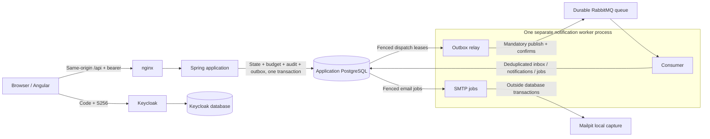

# ProcureFlow

ProcureFlow is a local/demo corporate purchase-request and approval application. It combines a Java/Spring backend with an Angular interface, intended to make engineering decisions understandable and verifiable in interviews.

**Current status: P0–P8.3b1 accepted locally and hosted; P8.3b2 (consumer unhandled exceptions) locally accepted after two review rounds, hosted CI pending; P8.4 pending; cloud deployment deferred.** [P8.3b1 hosted run 39783439652](https://github.com/kemselcuk/procureflow/actions/runs/39783439652), revision `7b07dd6`, passed **290 backend tests, 469 Angular tests, 71 Python verifier tests, seven real Chromium journeys** and the full seven-service/foundation recovery suite. See [P8.3b1 acceptance and limitations](docs/PLAN.md#p83b1-implementation-review-and-local-acceptance). [P8.3a hosted run 39772693077](https://github.com/kemselcuk/procureflow/actions/runs/39772693077), revision `d5c5b7a`, passed **288 backend tests, 469 Angular tests, 71 Python verifier tests, seven real Chromium journeys** and the full seven-service/foundation recovery suite. Fresh-checkout interactive setup and PostgreSQL edited-state preservation also passed locally; this is not broker-recreation or backup/restore proof. See [P8.3a acceptance and limitations](docs/PLAN.md#p83a-implementation-review-and-local-acceptance) and [P7 handoff](docs/PLAN.md#p7-fresh-checkout-evidence-and-handoff-acceptance).

P8.1 adds browser CSP/clickjacking headers, a 16 KiB application JSON bound behind nginx's 64 KiB edge, a one-shot Flyway `migrate` service that keeps the schema-owner credential out of the long-lived app, separate worker scheduler capacity for blocked SMTP, a shared audit page cap and an audited Vite override for the dev toolchain. Both local and hosted runs cover the full disposable foundation: migrate/header/body/OIDC/recovery/restart/scheduler checks and owned cleanup.

P8.2 adds an application-side fail-closed schema-version gate, a query-count/EXPLAIN harness, bulk actor and membership reads, one-snapshot count+page queries, a conflict-safe first budget period and the additive V6 indexes. Local and hosted evidence is **278 Java, 469 Angular, 62 Python, 7 Chromium and eight recovery cases**; see [P8.2 evidence and limits](docs/PLAN.md#p82-implementation-review-and-local-acceptance).

P8.3a bounds notification fan-out: recipients are split into deterministic 40-recipient canonical events, each with its own event/dispatch/recipient rows while the business transition keeps one history and audit row. A 16 KiB serialized-envelope guard halves a too-large batch and fails the command loudly if one recipient cannot fit. A real-PostgreSQL 551-recipient case produced 14 events, a 6,284-byte maximum stored body, 551 in-app and 551 email jobs, no `MALFORMED_MESSAGE` diagnostic, and duplicate materialization suppressed everything on the second pass. The operator-run retention SQL previews and deletes only old raw diagnostics; event-scoped quarantine and replay fingerprints are retained. Local and hosted evidence is **288 Java and 71 Python**; [P8.3a hosted run 39772693077](https://github.com/kemselcuk/procureflow/actions/runs/39772693077) passed all four jobs. P8.3b1 then added the broker-recreation evidence below (**290 Java** on [run 39783439652](https://github.com/kemselcuk/procureflow/actions/runs/39783439652)). A real PostgreSQL/RabbitMQ worker test consumes 551 recipients across 14 batched events and a 41-recipient boundary, and its negative control shows the old 551-recipient single envelope is quarantined as `malformed_message`. The 40-recipient value bounds one event body, not total recipients or transaction work: a 10,000-recipient company would still create roughly 250 events and 10,000 recipient inserts in one submit transaction, with no product cap or async fan-out. Target scale remains deferred. See [P8.3a limits](docs/PLAN.md#p83a-implementation-review-and-local-acceptance).

P8.3b1 fixes the broker identity for **new installs**: the RabbitMQ service now uses `procureflow-rabbitmq` / `rabbit@procureflow-rabbitmq`, so a recreated container on a retained volume reopens the same durable queue. A real Docker regression removes and recreates the broker on a retained named volume, proves the persistent queued envelope (message ID, payload, `delivery_mode=2`) is still there and drained by the real consumer, and a negative control shows that a changed node identity on the same volume loses the old queue (404). It also runs the existing company/event-scoped `replay_notification_event.sql` after an intentional empty-broker replacement: wrong company/event pairs are refused, the selected dispatch returns to `PENDING`, duplicate delivery adds no second inbox/in-app/email effect, and unrelated-company effects plus `SENT`/`SKIPPED` state stay unchanged. **Existing populated volumes are not migrated automatically:** after pulling this change, the first `up` recreates the broker under the new identity and does not open the old node directory; already `PUBLISHED` dispatches are not auto-republished. Drain the worker/queue or deliberately replace the broker and run the scoped replay procedure; never reset a volume or delete deduplication rows. See [P8.3b1 evidence and limits](docs/PLAN.md#p83b1-implementation-review-and-local-acceptance).

P8.3b2 bounds unexpected consumer runtime failures. A new transient `unhandled_consumer_failure` diagnostic is written in a short transaction with only the fixed code, a sanitized fingerprint and attempt counts; the throwable, body, headers and exception text are never logged or persisted. The delivery is acknowledged only after durable terminal evidence, and a failed diagnostic write leaves it unacknowledged. The same bounded path covers an unexpected parser failure before an envelope identity exists (NULL company/event raw scope) and an unexpected canonical-read failure. The company/event-scoped replay procedure now derives and deletes **both** raw transient fingerprints (`materialization_failed` and `unhandled_consumer_failure`) from the selected canonical publisher bytes, so a corrected replay materializes exactly once instead of silently ACK-ing. Local evidence is **297 Java, 71 Python, 30 foundation PASS and 7 Chromium**; two independent review rounds closed the raw-replay gap and the boundary tests. See [P8.3b2 evidence and limits](docs/PLAN.md#p83b2-implementation-review-and-local-acceptance).

The [P4 database foundation](docs/PLAN.md#p4-execution-record) is separately reviewed and locally/hosted verified: [run 39158792532](https://github.com/kemselcuk/procureflow/actions/runs/39158792532), revision `adf11c3`, passed **117 backend tests**, **14 Angular tests** and fresh Compose/Keycloak regression. A data-preserving V4→V5 database upgrade also passed locally. This is not full P4 acceptance; broker publication, notification APIs, consumption and SMTP delivery remain unimplemented in that revision.

The notification API is independently reviewed and locally/hosted verified with **133 backend tests**: own-notification list/read and company-admin backlog counts. [Hosted run 39161302004](https://github.com/kemselcuk/procureflow/actions/runs/39161302004) passed on revision `4b85a61`, together with 14 Angular tests and Compose/Keycloak regression. API tests seed delivery records rather than proving message consumption. See [API evidence](docs/PLAN.md#p4-notification-api-candidate).

The relay publishes persistent events with mandatory routing, confirms, fenced leases and bounded retries/quarantine. Consumer materialization and SMTP are integrated and independently verified locally and on hosted CI. See [relay history](docs/PLAN.md#p4-relay-candidate-review-pending) and [complete P4 acceptance](docs/PLAN.md#hosted-p4-acceptance).

The notification panel is published as `c9b7d4f`: [hosted run 39183791303](https://github.com/kemselcuk/procureflow/actions/runs/39183791303) passed **156 backend + 78 Angular tests**, typecheck/build and six-service Compose/Keycloak regression. Separate local rendered-browser checks passed real API login/read/token-refresh/logout and already-open-panel revocation. They use explicitly seeded notification fixtures, not a running consumer; no broker-to-panel or email delivery is claimed. See [panel evidence and limits](docs/PLAN.md#panel-live-apioidc-evidence-review-bounded-acceptance).

## Project documents

- [Implementation plan and progress](docs/PLAN.md): scope, task owners, dependencies, acceptance criteria, estimates, risks and current progress.
- [Decision record](docs/DECISIONS.md): architectural reasoning, version research and important trade-offs.

Each subject has one authoritative document. This README is the entry point for running and evaluating the implemented product.

## Architecture and consistency boundaries



The two databases share the local PostgreSQL service but use different credentials and purposes. Keycloak proves identity; current application membership selects company, department and roles. An administrator role does not grant unrestricted purchase access. The application never calls the broker or SMTP while committing business operations. The worker does not import purchase/budget repositories and its database role cannot mutate those records. No Redis or extra microservice is needed for these guarantees.

```mermaid
sequenceDiagram
  participant UI as Angular approval inbox
  participant API as RequestCommands
  participant DB as PostgreSQL
  participant W as Notification worker
  participant MQ as RabbitMQ
  participant SMTP as Mailpit
  UI->>API: Approve request with observed version
  API->>DB: Begin; current membership + company barrier + request lock
  API->>DB: Validate role, actor separation and pending version
  opt Final approval only
    API->>DB: Lock UTC-month budget; check used + amount <= limit
    API->>DB: Update usage and insert unique charge
  end
  API->>DB: State + approval/history + audit + canonical event/recipients
  DB-->>API: Commit all, or roll back all
  API-->>UI: Saved current state, or explicit conflict/denial
  W->>DB: Claim committed dispatch with fenced lease
  W->>MQ: Publish persistent canonical event
  MQ-->>W: Confirm / return / failure
  MQ->>W: Deliver event
  W->>DB: Commit deduplicated notification/email-job effects
  W->>MQ: ACK only after durable outcome
  W->>DB: Claim eligible email job and commit claim
  W->>SMTP: Send without an open database transaction
  SMTP-->>W: Accept or fail
  W->>DB: Fenced SENT save or bounded retry/quarantine
```

The synchronous boundary is implemented by [RequestCommands](backend/app/src/main/java/com/procureflow/app/requests/RequestCommands.java), [BudgetCharger](backend/app/src/main/java/com/procureflow/app/budgets/BudgetCharger.java), [ActorAccess](backend/app/src/main/java/com/procureflow/app/identity/ActorAccess.java) and [RequestEvents](backend/app/src/main/java/com/procureflow/app/requests/RequestEvents.java). The asynchronous boundary lives in [relay](backend/notification-worker/src/main/java/com/procureflow/worker/relay), [consumer](backend/notification-worker/src/main/java/com/procureflow/worker/consumer) and [email jobs](backend/notification-worker/src/main/java/com/procureflow/worker/email). Database uniqueness/fencing handles redelivery; an SMTP acceptance followed by a crash before the SENT save can still send twice. Neither the diagram nor a stable Message-ID promises exactly-once email.

## Implemented product

- Java 21/Maven multi-module build: Spring Boot app, separate relay/consumer/SMTP worker and immutable schema-v1 event records. Database effects deduplicate; SMTP is at-least-once, not exactly-once.
- Public system/OIDC configuration, OpenAPI and health endpoints; protected identity, company-membership, department and monthly-budget APIs; request lifecycle and department/finance approval with atomic budget checks, independently reviewed and locally verified.
- Flyway schema with tenant-composite constraints; separate runtime/migration/Keycloak database credentials; append-only request history, audit and outbox events. P3 adds immutable approval steps/charges and deferred settlement checks. Final usage, charge, state, history, audit and event/recipient capture share one transaction.
- V5 adds tenant-linked dispatch/inbox/delivery/notification/email-job tables, atomic dispatch initialization and a restricted worker database login. The running pipeline revalidates membership before delivery and supports scoped privileged replay.
- Routed standalone Angular screens for own requests, create/edit/detail/history, approval inbox, budgets, department/membership administration, metadata-only audit and notifications. Keycloak Code+PKCE, current-membership guards and explicit loading/failure/retry states; backend authorization remains authoritative.
- Pinned multi-stage containers and Compose, checked locally and on standard Ubuntu GitHub runners; a least-permission CI workflow repeats the foundation checks without deployment or paid storage.

## Intended product

Employees submit purchase requests. Department managers approve requests within their department; requests above EUR 1,000 additionally require a different finance approver. Company administrators manage departments, memberships and sample monthly budgets. A requester cannot approve their own request.

All company and department budgets are fictional application data. Approvals update database records and never initiate payments. The real infrastructure spending limit is documented separately in the [plan](docs/PLAN.md#cost-and-cloud-boundary).

The application includes company isolation, role-based authorization, request history, a budget overview, an approval inbox and notifications. The English interface uses a simple corporate design. Final system acceptance and handoff remain tracked in the plan.

## Technology to purpose to evidence

Status is deliberately scoped: P0–P6 have hosted browser/backend/frontend/system evidence on one reviewed revision; P7's interactive setup, PostgreSQL preservation and documentation handoff passed local verification and independent review. P8.1 security hardening is accepted locally and on exact-revision hosted CI after independent review and reruns. Observed runs and limitations are recorded in the [plan](docs/PLAN.md#p81-implementation-review-and-local-acceptance). Recovery timings are small-fixture observations, not an SLA, performance benchmark or coverage claim.

| Technology | Intended purpose | Code / configuration | Evidence / remaining gate |
| --- | --- | --- | --- |
| Java 21, Spring Boot, Maven | Modular monolith and separate notification worker | [Build](pom.xml), [app](backend/app), [worker](backend/notification-worker) | Java 21.0.12.1 builds; JPA usage/version and JDBC request/history/charge/audit/outbox rollback passed locally/hosted; see P3 evidence |
| Spring Security, Keycloak/OIDC | Login, validated JWTs and company-scoped permissions | [Identity](backend/app/src/main/java/com/procureflow/app/identity), [realm](infra/keycloak/procureflow-realm.json), [adapter boundary](frontend/src/app/authentication.ts) | [Security tests](backend/app/src/test/java/com/procureflow/app/IdentityAccessIT.java), [real-provider probe](scripts/oidc_smoke.py) and independent R1/R2 reviews passed; [P1 evidence](docs/PLAN.md#p1-execution-record) |
| JPA/Hibernate, PostgreSQL | Persistence, tenant relationships and concurrency control | [Budget mappings/charger](backend/app/src/main/java/com/procureflow/app/budgets), [access queries](backend/app/src/main/java/com/procureflow/app/identity/ActorAccess.java) | Real PostgreSQL 18.6; observed lock-barrier races for both final routes and administrator limit changes, plus post-flush failure rollback. Independent R1/R2 review and local/hosted gates passed |
| Flyway | Reproducible schema and constraints | [Migrations](backend/app/src/main/resources/db/migration), [foundation test](backend/app/src/test/java/com/procureflow/app/FoundationIT.java), [V6 upgrade](backend/app/src/test/java/com/procureflow/app/SchemaV6UpgradeIT.java), [schema gate](backend/app/src/main/java/com/procureflow/app/config/SchemaVersionCheck.java) | V1–V6 migration/validation, V3→V4 compatibility and hosted V6 passed. The one-shot `migrate` service owns migrations; the app starts with Flyway disabled, no schema-owner password and a fail-closed expected-version gate (default 6). V6 adds two EXPLAIN-supported indexes to a populated V5 schema without changing row data; [P8.2 limits](docs/PLAN.md#p82-implementation-review-and-local-acceptance) |
| Angular/TypeScript | Routed purchasing, approval, budget and administration UI | [Frontend](frontend/src/app), [bootstrap tests](frontend/src/app/workspace/auth-bootstrap.spec.ts), [session](frontend/src/app/workspace/workspace-session.ts) | 469 tests, pinned-lock install, typecheck/build/audit passed independently locally and on [P5 hosted CI](https://github.com/kemselcuk/procureflow/actions/runs/39340590010). P8.1's audited `@angular/build → vite 8.3.4` tooling override keeps audit at 0 vulnerabilities without changing the runtime bundle. Separate local browser checks cover actual role holders, stale/budget denial, notifications, narrow layouts and revocation |
| Transactional outbox; RabbitMQ | Recoverable publication and deduplicated notification effects | [Capture](backend/app/src/main/java/com/procureflow/app/requests/RequestEvents.java), [relay](backend/notification-worker/src/main/java/com/procureflow/worker/relay), [consumer](backend/notification-worker/src/main/java/com/procureflow/worker/consumer) | Real PostgreSQL/RabbitMQ tests and stopped-worker/broker/poison/replay cases passed locally; [final P4 evidence](docs/PLAN.md#final-p4-local-integration-gate) |
| Mailpit | Inspect locally delivered demo email | [SMTP jobs](backend/notification-worker/src/main/java/com/procureflow/worker/email), [Compose](compose.yaml) | 16 SENT jobs correlated to captures across cases; real outage recovery passed locally. Acceptance-before-save can duplicate email; no external delivery claim |
| JUnit, Mockito, Testcontainers | Verify behavior at its real boundary | [HTTP](backend/app/src/test/java/com/procureflow/app/system/FoundationHttpBoundaryTest.java), [migrations/OpenAPI](backend/app/src/test/java/com/procureflow/app/FoundationIT.java), [security/database](backend/app/src/test/java/com/procureflow/app/IdentityAccessIT.java), [requests](backend/app/src/test/java/com/procureflow/app/RequestLifecycleIT.java), [approval/budget](backend/app/src/test/java/com/procureflow/app/ApprovalBudgetIT.java), [delivery schema](backend/app/src/test/java/com/procureflow/app/NotificationDeliverySchemaIT.java), [request body bound](backend/app/src/test/java/com/procureflow/app/RequestSizeBoundIT.java), [schema/V6](backend/app/src/test/java/com/procureflow/app/SchemaVersionFailClosedIT.java), [fan-out](backend/app/src/test/java/com/procureflow/app/requests/RequestEventFanoutIT.java), [real consumer fan-out](backend/notification-worker/src/test/java/com/procureflow/worker/consumer/ConsumerBatchedFanoutIT.java), [worker tests](backend/notification-worker/src/test) | **181 app + 116 worker = 297 cases** passed locally on P8.3b2, including bounded unhandled-consumer/replay cases, real Docker broker recreation/replay, real PostgreSQL/RabbitMQ fan-out, schema/V6, budget race, query-count and body-bound cases; hosted P8.3b2 CI pending |
| Data-access hardening | Query scope, pagination, schema gate and budget creation | [ActorAccess](backend/app/src/main/java/com/procureflow/app/identity/ActorAccess.java), [queries](backend/app/src/main/java/com/procureflow/app/requests/RequestRepository.java), [V6](backend/app/src/main/resources/db/migration/V6__data_access_indexes_and_schema_version.sql) | 100-member admin list 2 statements; actor snapshot 1; command 3; request/notification pages 1; deterministic EXPLAIN shows lower cost/buffers; V5→V6 checksums unchanged. Passed locally and on P8.2 hosted CI |
| Notification fan-out and retention | Many recipients without malformed quarantine; bounded operator cleanup | [fan-out](backend/app/src/main/java/com/procureflow/app/requests/RequestEvents.java), [producer test](backend/app/src/test/java/com/procureflow/app/requests/RequestEventFanoutIT.java), [real consumer test](backend/notification-worker/src/test/java/com/procureflow/worker/consumer/ConsumerBatchedFanoutIT.java), [retention SQL](scripts/retention_notification_diagnostic.sql), [retention tests](scripts/test_retention_sql.py) | 551 recipients → 14 events, max 6,284-byte stored body vs 65,536 consumer limit, 551 in-app and 551 email jobs, duplicate suppression, no diagnostic; real PostgreSQL/RabbitMQ consumer path and malformed negative control pass. Retention previews and removes only old raw non-replay rows. Broker recreation/replay remain P8.3b |
| Browser security | CSP, clickjacking and request bounds | [nginx](frontend/nginx.conf), [body filter](backend/app/src/main/java/com/procureflow/app/config/JsonRequestBodyLimitFilter.java), [browser assertions](e2e/tests/critical.spec.ts) | Real Chromium asserts parsed `script-src 'self'` (no weak tokens), XFO/COOP/frame-ancestors, blocked foreign iframe, zero CSP violations; declared/chunked oversize returns 413 on direct and proxied paths. Passed locally and on P8.1 hosted CI |
| Playwright | Repeatable browser checks of critical product journeys | [Critical suite](e2e/tests/critical.spec.ts), [shared test contract](e2e/critical-tests.json), [disposable runner](scripts/check-browser.py) | Seven real-browser cases passed independently locally and on [P8.2 hosted CI](https://github.com/kemselcuk/procureflow/actions/runs/39703894399), using Playwright 1.60.0/official Chromium 148.0.7778.96; 71 Python verifier checks also passed on [P8.3a hosted CI](https://github.com/kemselcuk/procureflow/actions/runs/39772693077) |
| Docker Compose | Reproduce the local application and messaging pipeline | [Compose](compose.yaml), [smoke check](scripts/check-foundation.py), [notification cases](scripts/notification_smoke.py), [broker recreation test](backend/notification-worker/src/test/java/com/procureflow/worker/relay/BrokerRecreationReplayIT.java) | Seven long-running services plus a one-shot `migrate` container; real OIDC/business regression, V6 schema6, eight notification cases, body/header/migrate/scheduler checks, fixed-identity broker recreation/replay, bounded unhandled-consumer/replay cases and exact fixture cleanup passed locally; P8.3b1 hosted CI passed |
| GitHub Actions | Repeat backend, frontend, browser and messaging recovery checks | [Workflow](.github/workflows/ci.yaml) | [Passing P8.3b1 run](https://github.com/kemselcuk/procureflow/actions/runs/39783439652): 290 backend, 469 Angular, 71 verifier tests, seven Chromium journeys and seven-service recovery; executable revision `7b07dd6` |
| Terraform, when a provider is chosen | Describe a future cloud environment | Provider-specific infrastructure, deferred | Formatting/validation evidence first; an actual deployment is a separate action |

## Local setup and checks

Prerequisites: a running Docker engine with Compose for containers/integration tests; a maintained JDK 21 and compatible Node 22 for host development; npm 10 and Python 3 for the smoke-check script. Checked locally on macOS arm64/Docker Desktop and on standard Ubuntu 24.04 GitHub runners. Check Docker Desktop's applicable licensing for your use. No paid/cloud service is needed.

Select JDK 21 explicitly before running Maven. On macOS, after installing a maintained JDK 21:

```sh
export JAVA_HOME="$(/usr/libexec/java_home -v 21)"
./mvnw --version
./mvnw verify
```

Maven rejects Java 25 rather than silently building with it. This session used a checksum-verified temporary Temurin 21.0.12.1+1 toolchain without replacing system Java. `verify` requires Docker and runs HTTP slice tests plus real PostgreSQL, RabbitMQ and Mailpit integration tests; `./mvnw test` alone does **not** prove database or delivery behavior. Reports are in each backend module's `target/surefire-reports/` and `target/failsafe-reports/` directories.

From `frontend/`, using the Node version in `.nvmrc`:

```sh
npm ci
npm run typecheck
npm test
npm run build
npm audit --audit-level=high
```

The lock includes a narrow `@angular/build → vite 8.3.4` tooling override to replace a vulnerable nested Vite 8.3.0. Keep the override and lock reviewed together; do not run `npm audit fix --force` (it downgrades Angular) and do not bypass the audit with `--omit=dev`. The local audit after the override is 0 vulnerabilities; Vite is not part of the shipped browser bundle.

To check disposable containers without a host JDK/Node installation:

```sh
python3 scripts/check-foundation.py
```

This builds three application images plus the pinned PostgreSQL image with its initialization hook, starts a one-shot `migrate` container and then seven long-running services: app, PostgreSQL, frontend, worker, pinned Keycloak, RabbitMQ and Mailpit in a unique local project. Secrets are generated only in memory. It checks readiness, API/OpenAPI/static routing, durable broker topology with an active consumer and Mailpit, plus real authorization-code + S256, code replay denial, refresh/logout and membership revocation. Business checks exercise draft retries, submission/history/rejection, scoped access, threshold approvals, separate actors and budget denial. Eight notification cases cover stopped-worker backlog, duplicate replay, broker and SMTP outages, malformed quarantine, canonical terminal replay, recipient revocation and final sums/queue drain. The OIDC probe uses real HTTP forms/protocol calls, **not rendered Angular**. The checker removes **only its own test containers and database/broker volumes**, leaves images/build cache and writes `target/foundation-smoke.json`. Recovery bounds start at the recorded readiness observation; total elapsed fields are separate, not a 60-second outage-start SLA. Loopback ports are isolated; issuer/redirect URLs are selected before realm import.

### Critical rendered-browser checks

The separate Playwright package uses the same Node 22/npm 10 prerequisites. Install its exact lock and official pinned Chromium, then run from the repository root:

```sh
cd e2e
npm ci
npm audit --audit-level=high
npm run typecheck
npx playwright install chromium
cd ..
python3 scripts/check-browser.py
```

On a fresh Linux host, use `npx playwright install --with-deps chromium` to install browser system prerequisites too. The runner requires an already-running Docker engine; it does not start or install one. It creates a unique seven-service worker-enabled project with generated credentials, reserved loopback OIDC/frontend ports and unique build-image tags. The seven serial browser journeys use actual fictional employee/manager/finance/admin sessions for requests, approvals, budget denial/limit retry, rejection, consumer-generated notification read persistence, cold links/foreign-company denial and mounted membership revocation. Narrow viewport and keyboard checks are included; the earlier broader P5 stale-edit evidence remains separate.

The runner rejects missing, skipped, partial or malformed results instead of treating a zero process exit alone as success. It writes sanitized `target/p6-browser/browser-run.json` and `browser-run.log`, then removes only its own containers/volumes/network/image tags and ephemeral browser artifacts, including on failure. Timeouts terminate only the command process group it created. Trace, video, HAR and storage-state retention are disabled because they can capture authentication material. Redaction covers generated secrets and defined token/header/callback formats, not every arbitrary possible secret. `P6_TMP_ROOT` optionally selects a temporary directory; `--browser-executable /absolute/path/to/chrome` explicitly overrides the default managed browser and is recorded as such. Do not confuse an override run with proof for the pinned official binary. Actual local/hosted acceptance is recorded in the plan.

For an interactive local/demo stack, set these eight environment variables using private terminal input or your local secret manager: `POSTGRES_PASSWORD`, `APP_DB_PASSWORD`, `MIGRATION_DB_PASSWORD`, `WORKER_DB_PASSWORD`, `RABBITMQ_PASSWORD`, `KEYCLOAK_DB_PASSWORD`, `KEYCLOAK_ADMIN_PASSWORD`, `DEMO_PASSWORD`. Use distinct local-only database/admin/broker passwords, not an account password; never paste them into chat, committed files or shared logs. `DEMO_PASSWORD` is the password you choose for the eight fictional demo identities. `.env.example` contains variable names only; no credentials are supplied by the repository. Keep the broker password stable when reusing its volume; changing an environment variable does not rotate an existing broker account.

```sh
# Core stack: the one-shot `migrate` service runs first and must exit 0.
docker compose up --build --wait postgres app frontend keycloak

# Full stack (same project, plus worker, broker and local mail capture).
docker compose --profile worker up --build --wait \
  postgres app frontend keycloak notification-worker rabbitmq mailpit
```

The `migrate` service is not a long-running wait target: it applies Flyway migrations with the schema-owner credential and exits. The application waits for `service_completed_successfully` and starts with Flyway disabled; if the schema is missing it fails closed through JPA validation. Check both states after startup with `docker compose --profile worker ps --all` (`migrate` must show `exited (0)`; the other seven must be healthy). Do not add `MIGRATION_DB_PASSWORD` to the long-lived app, worker or frontend containers.

Open `http://localhost:4200`, `http://localhost:8080/v3/api-docs` and local Keycloak at `http://localhost:8180`. Default ports are 4200, 8080, 5432 and 8180; override `FRONTEND_PORT`, `APP_PORT`, `POSTGRES_PORT` or `KEYCLOAK_PORT` before startup if occupied. The frontend proxies API calls to the backend. The worker profile also starts RabbitMQ, Mailpit and the notification worker (relay, consumer and SMTP jobs). Worker health is on loopback port 8081, AMQP on 5672 and broker management on 15672; override `WORKER_PORT`, `RABBITMQ_AMQP_PORT` or `RABBITMQ_MANAGEMENT_PORT` if needed. Broker login is `procureflow` with your private `RABBITMQ_PASSWORD`. Mailpit's capture UI is `http://localhost:8025`, SMTP port 1025; override `MAILPIT_UI_PORT` or `MAILPIT_SMTP_PORT` if occupied. Mailpit has no local authentication, so both host ports stay loopback-only. It captures only fictional `<identity-UUID>@demo.invalid` recipients and discards its temporary mailbox when the container stops; durable job state lives in PostgreSQL. App purchase operations do not connect to RabbitMQ or SMTP. Combined recovery passed independently locally and on hosted CI, as recorded in the plan.

The Compose configuration explicitly enables the `local-demo` application profile and imports a local-only Keycloak realm. Fictional accounts are `a-employee`, `a-manager`, `a-finance`, `a-admin` for Larkvane, and the corresponding `b-…` accounts for Northstar. Each company has engineering/operations departments. Business roles live in the application database, not in token role claims. The Keycloak administration account is `local-admin` with your `KEYCLOAK_ADMIN_PASSWORD`; application company administrators are not Keycloak administrators. Account/password management stays in Keycloak. Realm startup import skips an existing realm; changing environment passwords does not reset existing users.

P3 demo startup adds a EUR 5,000 current-UTC-month budget for each company's **engineering and operations departments**, plus four drafts per company: EUR 999.99, 1,000.00, 1,000.01 and 6,000.00. Submit through **My requests** as the employee, then use **Approvals** as the department manager and, above EUR 1,000, a different finance approver. The final amount exceeds the seed limit. Repeat startup inserts only missing fixtures and never overwrites edited drafts, limits or later revocations. New months receive no automatic approval-time budget; an administrator must configure one (demo startup may seed its current month).

Host application runs without `local-demo` do not seed company data. Unknown valid identities may self-register, but cannot access company endpoints until an administrator explicitly assigns an active membership. Company administration endpoints and exact scopes are in the [P1 matrix](docs/PLAN.md#p1-endpointaction-matrix). **Administration** links already-registered identities to departments and roles; account/password creation stays in Keycloak. **Budgets** manages fictional monthly limits; **Audit** exposes company-scoped metadata, not purchase content or approval overrides.

Request API inputs/scopes are in the [P2 matrix](docs/PLAN.md#p2-endpointaction-and-retry-contract) and [P3 contract](docs/PLAN.md#p3--final-approval-and-budget-correctness). Create/submit require a UUID `Idempotency-Key`; identical retries preserve the original result/correlation ID, even if the resource has since changed. Follow with GET for current state. Edit/cancel/reject/approve use the last observed `version` and return 409 for stale commands. Approve takes no idempotency key; retrying a completed approval cannot charge twice. Final views expose `approvedAt` and UTC `budgetMonth`; `budget_missing`/`insufficient_budget` leave the request pending. A `retryable_conflict` means retry after the competing transaction settles, retaining the same create/submit key. The UI retains unchanged ambiguous create/submit retry keys, preserves edits on stale-version errors and requires explicit reload/retry rather than automatically repeating decisions.

Navigation links reflect current server membership; hiding a link is not authorization. Deep links use the same exact root OIDC callback as login/logout. Only a validated internal pathname with a ten-minute expiry may briefly persist in per-tab session storage; tokens, callback values, profiles and form data are not stored there. Successful restoration consumes it, and logout clears it. See [callback ownership](docs/DECISIONS.md#d013--oidc-callback-ownership-before-router-navigation).

Keep the same password environment when reusing a volume; do not regenerate it between restarts. For routine full-stack pauses, use `docker compose --profile worker stop` and `docker compose --profile worker start --wait`, preserving the existing containers. `down` preserves named volume files but removes containers; it is **not** a broker-message-preserving restart guarantee. The RabbitMQ recreation limitation below matters even without `--volumes`. **Destructive local reset:** `docker compose --profile worker down --volumes` deletes the selected project's application/Keycloak databases and broker data; use it only for disposable data. Existing P0-only volumes lack the separated database roles because PostgreSQL init scripts run only on an empty volume: migrate roles deliberately or reset only your disposable local data. Never silently delete a volume to bypass this prerequisite.

### Local operator checklist

- Use an explicit project name (`docker compose -p <your-project> …`) when running several copies; carry the same name, ports and password environment through every command. Never run a reset against an unidentified project.
- For the full stack, `docker compose --profile worker ps` shows the seven running services; add `--all` to include the one-shot `migrate` container and confirm it is `exited (0)`. App/worker readiness is `/actuator/health/readiness`; it includes database connectivity, **not** proof that every message or email is delivered. Check the administrator backlog endpoint and Mailpit separately. Frontend `/health` only proves nginx responds.
- Browser security: nginx serves the SPA with a same-origin CSP (`script-src 'self'`, `frame-ancestors 'none'`), `X-Frame-Options: DENY`, COOP and nosniff. The production build has no inline script because critical-CSS inlining is disabled; `style-src 'unsafe-inline'` remains necessary for Angular's runtime component styles. The local CSP allows loopback Keycloak origins on any port because the development issuer port is configurable; a non-loopback deployment must pin the exact issuer origin instead. Do not weaken `script-src` or add `unsafe-inline` scripts to make a local shortcut work.
- Request and migration bounds: nginx caps a request body at 64 KiB, and the application independently caps JSON bodies at 16 KiB before deserialization, returning `413 payload_too_large`; authentication still runs first. Among the application-image services, only the one-shot `migrate` container receives the schema-owner password; the PostgreSQL init step also receives it to create roles on an empty volume. The worker uses two scheduler threads so a blocked SMTP send cannot delay outbox publication; its database-fenced leases remain unchanged. Audit pagination accepts `page` up to 1,000,000 (same policy as request and notification lists) and rejects larger values with `400 invalid_request`.
- Routine pause/resume: `docker compose --profile worker stop`, then `docker compose --profile worker start --wait postgres app frontend keycloak notification-worker rabbitmq mailpit` with the same project/settings. Name the seven long-running services explicitly: the one-shot `migrate` container is not a valid `start --wait` target. This keeps the existing broker container/node identity. After the start, `docker compose --profile worker ps --all` must still show `migrate` as `exited (0)` and the app healthy. Use `up --build --wait` with the documented service list for initial creation or deliberate updates; it is not proof that every stateful service can be safely recreated.
- Schema upgrades: the application expects Flyway version 6 by default and fails closed on an older or unsuccessful schema. `start --wait` does not run the one-shot migrate service, so after pulling a new migration on an existing volume use the documented `up --build --wait` list (or `docker compose run --rm migrate` followed by a start) and verify `migrate` exited 0. Do not override `APP_SCHEMA_EXPECTED_VERSION` to bypass a mismatch, and do not reset the volume. V6 indexes are created non-concurrently for this local/demo stack; a large existing database needs a separately reviewed online migration plan. The worker is not yet schema-gated; do not run a non-additive future migration without a shared gate.
- PostgreSQL and RabbitMQ use named volumes. The RabbitMQ service now sets a fixed hostname/node name (`procureflow-rabbitmq` / `rabbit@procureflow-rabbitmq`) for **new installs**, and a real regression proves a durable queued message survives container removal/recreation on the retained volume. This applies mechanically to an existing populated volume too: after pulling this change, the first `up` recreates the broker under the new identity and does **not** open the old node directory; the old queue becomes invisible and already `PUBLISHED` dispatches are not automatically republished. Existing-volume migration is **not automatic**. Before upgrading, drain the worker/queue or deliberately replace the broker, then run the company/event-scoped [replay procedure](scripts/replay_notification_event.sql) and verify deduplication plus preserved `SENT`/`SKIPPED` effects. Do not reset a volume, rename an existing node or delete deduplication rows. The negative control in the recreation test demonstrates the changed-identity failure mode; no pre-change volume was read or modified.
- Mailpit's temporary mailbox disappears when its container is removed; durable SENT jobs are not automatically sent again to refill it. A PostgreSQL down/up persistence check establishes database state survival, not RabbitMQ recreation or backup/restore.
- Treat database role creation, password rotation, migrations and business-event replay as separate deliberate operations. Changing Compose environment values does not rotate existing PostgreSQL/RabbitMQ/Keycloak credentials. Never dump resolved Compose configuration/container environments or share raw authenticated browser traces.
- A full-stack **destructive disposable reset** is `docker compose --profile worker down --volumes`; it deletes that selected project's application/Keycloak databases and broker data. This is not a routine repair or a backup. The automated checkers already isolate and clean only their own fixtures.
- Failed deliveries may be pending/retrying, skipped for revoked membership, or quarantined. Correct the recorded cause before using the scoped recovery procedures below; never delete deduplication records to force an email resend.

For frontend hot reload, keep the backend on port 8080 and run `npm start` from `frontend/` after stopping the frontend container; the development proxy forwards `/api/**` and OpenAPI to that backend. The service is loopback-only.

### Existing P1–P3 volume: add the worker login before V5

PostgreSQL initialization does not rerun on an existing volume. Keep all existing passwords unchanged, choose a new private `WORKER_DB_PASSWORD`, and provision the missing role before starting the V5 app. For the default Compose database, run the following **only when `procureflow_worker` does not already exist**; an existing role needs deliberate privilege/password inspection, not an automatic reset:

```sh
docker compose up -d postgres
docker compose exec -T postgres psql -U procureflow -d procureflow -v ON_ERROR_STOP=1 <<'SQL'
\getenv worker_password WORKER_DB_PASSWORD
\getenv app_database POSTGRES_DB
CREATE ROLE procureflow_worker LOGIN PASSWORD :'worker_password';
GRANT CONNECT ON DATABASE :"app_database" TO procureflow_worker;
GRANT USAGE ON SCHEMA public TO procureflow_worker;
SQL
docker compose up --build --wait postgres app frontend keycloak
```

The quoted heredoc reads the password from the container environment rather than embedding a value in the command. Do not enable shell/SQL tracing or share credential-bearing output. V5 grants only the required delivery-table and metadata capabilities; it does not grant purchase/budget mutation or Keycloak access. If the role, database CONNECT or schema USAGE prerequisite is missing, V5 stops with an explicit error. No volume reset is required. Existing P0-only volumes also need the earlier P1 role separation before this step.

## Notification API

An active member can use `GET /api/notifications?page=0&size=20` and bodyless `POST /api/notifications/{id}/read`. The list exposes only event metadata; marking read preserves the first timestamp on retries. Another owner's or company's notification returns 404. `GET /api/admin/notifications/backlog` returns fixed own-company counts and requires the current company-administrator role. Authentication and membership are checked on every call; notification metadata does not grant access to purchase content. These endpoints do not themselves create notifications or send email.

### Worker delivery and operator recovery

The worker publishes committed canonical events, consumes them into unique in-app notifications and initial email jobs, then sends those jobs to Mailpit. Consumer effects commit before broker acknowledgement; SMTP runs outside database transactions. A captured recipient whose membership is no longer active is skipped, not rerouted to another identity/company. The separate worker login cannot mutate purchases, budgets, business audit or immutable events. The business app does not need broker/SMTP availability to commit a request.

Inspect own-company counts through the admin backlog API. Detailed failure codes/fingerprints and scoped maintenance require a privileged local database operator, not merely a company-admin application account. The consumer stores sanitized diagnostic hashes/codes, never arbitrary message bodies; event-level diagnostics use the `IN_APP` channel convention. Unexpected runtime failures are bounded under `unhandled_consumer_failure` and acknowledged only with durable terminal evidence; the scoped replay derives and clears both raw transient fingerprints (`materialization_failed`, `unhandled_consumer_failure`) from the selected canonical publisher bytes. Raw unhandled rows may also age out under the operator retention window; if that happens before a replay, the republished message is re-attempted within the bounded budget rather than silently ACK-ed. A transient `materialization_failed` diagnostic is terminal at the configured `worker.consumer.max-attempts` threshold (default 5); permanent validation codes are terminal immediately. An unknown malformed body's hash cannot reconstruct it for replay.

For a corrected event failure, first stop **only the worker in the intended development project**:

```sh
docker compose --profile worker stop notification-worker
docker compose exec postgres psql -U procureflow -d procureflow
```

Inspect the fixed failure code and correct its cause first; replay does not repair missing database privileges or SMTP availability. Copy the contents of the shared [event replay procedure](scripts/replay_notification_event.sql) into the maintenance session, replacing `<company-id>` and `<event-id>` with the explicit selected UUIDs **before execution**. The unchanged placeholders deliberately fail UUID parsing. The smoke and real database/broker regression execute this same SQL file rather than maintaining a second procedure in the documentation.

The row-locked procedure refuses missing/foreign-company rows, live leases and dispatch states other than `PUBLISHED`/`QUARANTINED`. It resets only the selected dispatch and its diagnostics. A valid canonical message can have an unscoped transient counter if canonical lookup previously failed: the procedure derives that exact counter from the immutable canonical publisher bytes and clears only its NULL-scoped `materialization_failed` fingerprint. Unrelated raw/malformed diagnostics remain untouched. A previously published event can be deliberately re-driven to recover consumer quarantine or verify deduplication; it is not an email resend command.

For a corrected SMTP failure, reset only the explicitly selected quarantined job instead:

```sql
BEGIN;
SELECT id, state, attempts FROM email_job
 WHERE id = '<job-id>'::uuid AND company_id = '<company-id>'::uuid FOR UPDATE;
UPDATE email_job
   SET state = 'PENDING', attempts = 0, next_attempt_at = now(),
       lease_token = NULL, lease_until = NULL, error_code = NULL
 WHERE id = '<job-id>'::uuid AND company_id = '<company-id>'::uuid AND state = 'QUARANTINED';
COMMIT;
```

Exit `psql`, then run `docker compose --profile worker start notification-worker`. Do not delete inbox, delivery, in-app or email rows to force a replay. Event/job IDs and first read times stay stable; `SENT`/`SKIPPED` jobs are not reopened. SMTP acceptance before the database save can still produce a duplicate on retry, including after explicit job replay; a stable Message-ID supports correlation but is not an exactly-once guarantee. The shared event replay procedure has independent component and full-stack evidence; SMTP job replay preserves the explicit company/job/state predicate. Detailed acceptance and limitations are recorded in the plan.

### Diagnostic retention

Raw transport/parse diagnostics are retained for investigation and replay; they are not deleted by the worker. A privileged operator may run the shared maintenance script in preview mode, review the counts, then apply one bounded batch and repeat until the deleted count is zero:

```sh
docker compose exec -T postgres psql -U procureflow -d procureflow \
  -v retention_days=90 -v batch_size=1000 -v preview=true -f - < scripts/retention_notification_diagnostic.sql
docker compose exec -T postgres psql -U procureflow -d procureflow \
  -v retention_days=90 -v batch_size=1000 -v preview=false -f - < scripts/retention_notification_diagnostic.sql
```

`retention_days`, `batch_size` and `preview` are required; missing/invalid values stop without deleting. The delete scope is exactly old raw rows (`company_id` and `event_id` null) whose code is not `materialization_failed`. Event-scoped terminal/quarantine rows, the raw replay fingerprints used by the event procedure, audit/history/outbox/inbox/delivery/in-app/email/command rows are never touched. There is no automatic retention job and no worker DELETE grant. The retention window is an operator policy, not a product default; do not run the apply command without reviewing the preview. No Prometheus metric is added in P8.3a; the preview counts are the operator observation.

## Product acceptance

Acceptance evidence covers three required scenarios:

1. Concurrent final approvals sharing one budget leave total usage within its limit and charge each approved request once.
2. Users cannot read or change another company's data or perform actions outside their role and department.
3. Notifications committed while the worker is stopped are completed after it restarts. Duplicate event delivery is safe for database effects; email delivery has the limitations recorded in the decision log.

The explicit local-demo profile contains two companies, multiple departments, distinct role holders and threshold/insufficient-budget draft fixtures. Database concurrency, notification recovery and committed rendered-browser journeys have local/hosted evidence on one reviewed revision. A fresh interactive checkout also preserved a UI-edited draft, budgets, memberships and seed counts after PostgreSQL volume reuse with unchanged credentials. That does not prove RabbitMQ recreation, backup/restore or production deployment; those limitations remain part of the accepted handoff.

## Delivery limits and a future public environment

This is a tested **local/demo application**, not a deployed public service. The Compose realm uses Keycloak `start-dev`, local HTTP and fictional credentials/accounts; Mailpit is a local capture sink. Do not expose this configuration unchanged to the internet. The app and worker use environment-supplied credentials, separate database roles, health checks and graceful shutdown; their durable state lives in PostgreSQL/RabbitMQ rather than local process memory. This is preparation, not a verified production deployment.

A future environment needs explicit HTTPS/public-origin and issuer/proxy configuration, production Keycloak configuration without demo seeding, private database/broker networking, external secret management and deliberate migrations/credential rotation. PostgreSQL backups must include both application and Keycloak data; persistent volumes and restart tests are **not backup/restore evidence**. Resolve the broker node-identity/recreation limitation, define and test restore procedures, broker recovery, alerting for backlog/quarantine and an authenticated email provider before making operational guarantees. No backup restoration, broker-container recreation persistence, multi-node failover, public TLS deployment, load/SLA or cross-browser certification is claimed.

Cloud provider selection, current pricing, Terraform configuration/validation/plan/apply, spend approval, deployment and deletion verification are separate future gates in the [plan](docs/PLAN.md#cost-and-cloud-boundary). No cloud resource, domain or paid service was created for this implementation. A demo video is not a deliverable.

Created in [T3 Code](https://t3.codes).

## License

Released under the [MIT License](LICENSE).
